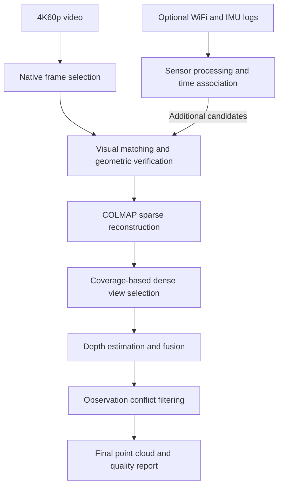

# Indoor 3D Reconstruction from Video

**A video-based reconstruction pipeline with WiFi and IMU assistance.**

This project reconstructs indoor scenes from 4K60p video using COLMAP, with WiFi observations and IMU-derived walking trajectories providing additional matching candidates. It covers frame selection, camera estimation, dense reconstruction, point-cloud filtering, and quality reporting through a single entry point.

Video is the only visual input: no separate photographs are required. Sensor recordings can start at a different time from the video; uncertain timing is handled through explicit uncertainty windows rather than assumed synchronization.

The primary output is a colored point cloud, accompanied by coverage diagnostics and records linking the result to its inputs and configuration.

[Quick Start](#quick-start) · [Pipeline](#pipeline) · [Sensor Assistance](#sensor-assistance) · [Configuration](#configuration) · [Outputs](#outputs) · [Recovery](#recovery) · [Limitations](#limitations)

## Features

| Capability | Approach |
| --- | --- |
| Native video frame selection | Preserves source resolution and selects sharper nearby original frames without synthesizing image content. |
| Capture coverage | Samples the full clip and balances sharpness, visual change, and temporal continuity. |
| Visual matching | Combines local and multiscale temporal pairs with additional appearance candidates for revisits and links between clips. |
| Sensor assistance | Uses WiFi fingerprints and continuous IMU/PDR route segments to propose matches that require visual geometric verification. |
| Adaptive dense reconstruction | Selects views using sparse-track coverage and time gaps, subject to configurable computational budgets. |
| Conservative point filtering | Removes assessed multi-view conflicts while retaining uncertain or unassessed points. |
| Inspectable results | Exports point clouds, quality reports, stage logs, and source identities for validation and recovery. |

## Pipeline



The default workflow produces observed geometry. Optional VideoScene completion is a separate, explicitly enabled step for local gaps with supporting observations.

All retained frames may participate in sparse reconstruction. Dense processing uses a selected subset to control computation while reporting the coverage that subset retains. Temporal candidates remain available to COLMAP even when a smaller visual preview is inconclusive; additional appearance and sensor candidates must pass preview geometry checks.

## Quick Start

### Requirements

- Windows or Linux with an NVIDIA CUDA GPU for the full reconstruction workflow.
- Python 3.10–3.12; the current development environment uses Python 3.10.
- A CUDA-enabled COLMAP distribution with the project's COLMAP 3.13-style command-line options, installed separately.
- Python dependencies from [requirements.txt](requirements.txt).

FFmpeg is optional; OpenCV also supports native video decoding. New workspaces use a shared Python stage executor on Windows and Linux. Generated `.bat` recipes remain the canonical stage configuration for provenance and Windows compatibility; the Python executor runs their supported commands directly without a command shell.

From the project directory:

```powershell
py -3.10 -m venv .venv
.\.venv\Scripts\python.exe -m pip install -r requirements.txt
.\.venv\Scripts\Activate.ps1
```

An existing compatible Conda environment can be used instead. Install dependencies with the same interpreter used to run the pipeline.

On Linux:

```bash
python3 -m venv .venv
source .venv/bin/activate
python -m pip install -r requirements.txt
python main.py --colmap-exe /path/to/colmap
```

Prepare the inputs described below before running the last command. A compatible `colmap` on `PATH` is detected automatically; `--colmap-dir` also accepts a Linux installation containing `bin/colmap`.

Before clearing a stopped run, `main.py` checks that the selected COLMAP executable runs, reports a CUDA build, and exposes the feature/matching and dense command options used by this pipeline. This check does not run reconstruction or certify GPU driver health. Linux discovery ignores bundled Windows executables.

### Prepare the inputs

```text
project/
├── main.py
├── requirements.txt
├── video/                       Input videos
├── <capture>.sess/              Supported WiFi/IMU session logs
├── video_sensor_sync.csv        Optional measured time correspondences
├── colmap-x64-windows-cuda/     Local COLMAP installation
└── generated/                   Generated data and reconstruction outputs
```

Use sensor logs from the same capture as the video. The pipeline reads the actual stream resolution, frame rate, and timestamps rather than assuming exactly 60 fps. COLMAP can also be supplied through `--colmap-exe`.

Each video receives a separate extraction directory, including clips with identical stems or non-ASCII names. If any clip cannot be decoded or yields no usable frames, preprocessing reports the affected files and stops before reconstruction so a partial capture is not silently treated as complete.

### Run

```powershell
python main.py
```

This starts video and sensor preprocessing, COLMAP reconstruction, point filtering, and quality reporting. To reconstruct without sensor logs:

```powershell
python main.py --video-only
```

The default final cloud is:

```text
generated/colmap_workspace/dense/final.ply
```

Open the PLY in a point-cloud viewer such as MeshLab. Inspect `quality_report.json` alongside the visual result.

> **Run behavior:** If the selected workspace is active, `main.py` follows its console output. Otherwise, it validates the inputs, clears the selected generated output directories, and starts a new reconstruction. This reset includes an existing `final.ply`. To preserve and continue a stopped run, use the [recovery commands](#recovery).

Nonempty custom output directories require a recorded owner or generated-output metadata before reset; a similar directory name alone is insufficient. Invalid numeric settings, missing masks and output paths that overlap selected tools are rejected before reset. Following an active run drains its final buffered output before returning the exit status.

## Sensor Assistance

Sensor processing is enabled by default. WiFi fingerprints suggest revisits, while IMU/PDR supplies supported route segments. These signals assist match retrieval; they do not directly set camera positions, orientations, or metric scale.

### Uncertain start-time offset

The default `--video-sensor-alignment fuzzy` combines embedded video recording time with the sensor clock to propose uncertain time windows. It does not assume simultaneous recording starts or use file-copy timestamps as capture times.

- `--video-sensor-time-uncertainty-s 30` assumes a window of ±30 seconds. This is a configurable tolerance, not measured accuracy.
- `--video-sensor-offset-s` adds a known correction to the embedded video clock, in seconds.
- Missing metadata, ambiguous sessions, or unstable clocks leave frames unassociated while preserving ordinary visual matching.

Fuzzy association retains time windows rather than inventing exact sensor samples or camera poses. Inspect `video_sensor_fuzzy_summary.json` and the workspace's `video_sensor_assistance` summary to see how much sensor evidence was usable.

### Measured synchronization

When time correspondences are known, provide a CSV with the following columns:

```csv
video_name,session,video_time_s,sensor_elapsed_ts
clip.mov,capture_session,0,10000
clip.mov,capture_session,60,70000
```

Replace these illustrative values with measured correspondences. Video time is in seconds; sensor elapsed time is in milliseconds. Two or more anchors estimate clock offset and drift within a supported interval. A single anchor assumes equal clock rates.

```powershell
python main.py --video-sensor-sync video_sensor_sync.csv
```

Explicit synchronization takes precedence over fuzzy association and is checked for timestamp validity, drift, and residual error. In the default sensor-assisted mode, a root-level `video_sensor_sync.csv` is discovered automatically unless automatic association is disabled. An explicit sync CSV also enables sensor processing when used with `--video-only`.

Use `--video-sensor-alignment strict` for explicit-anchor association only, or `off` to disable fuzzy and automatically discovered association while retaining sensor preprocessing.

## Configuration

These defaults apply when `main.py` creates a new workspace. Explicit options take precedence; existing workspaces retain their recorded settings.

| Option | Default | Purpose |
| --- | --- | --- |
| `--reconstruction-profile` | `final` | Reconstruction settings; `auto` selects a profile using the current GPU. |
| `--video-frame-interval-s` | `0.5` | Two candidate frames per second across the full clip. |
| `--video-max-frames` | `0` | No per-video candidate-frame cap. |
| `--video-blur-policy` | `adaptive` | Selects frames using relative sharpness and detail checks. |
| `--video-refine-window-s` | `0.25` | Searches nearby native frames; the effective radius is limited by the sampling interval. |
| `--visual-recovery-neighbors` | `12` | Additional appearance-retrieval budget per image. |
| `--colmap-dense-profile` | `efficient` | Dense settings with geometric consistency checks. |
| `--dense-selection-mode` | `adaptive` | Adds views where coverage targets remain unmet. |
| `--dense-initial-images` | `480` | Initial dense-view budget. |
| `--dense-max-images` | `1200` | Hard dense-view limit; `0` requests all eligible views. |
| `--dense-max-source-images` | `12` | Maximum source views per dense reference. |
| `--point-filter-method` | `observed` | Preserves uncertain points and filters assessed conflicts. |
| `--cpu-workers` | `0` | Shared default budget: all CPUs available to this process. Positive stage overrides take precedence. |
| `--video-hw-decode` | `auto` | Prefer available hardware video decoding; use `off` for software decoding. CPU thread budgets remain unchanged. |
| `--video-hw-device` | `-1` | Automatic video adapter selection. Windows prefers an NVIDIA DXGI adapter; explicit indices belong to the video backend, not CUDA. |
| `--video-decode-threads` | `0` | Inherits the CPU budget for native video decoding and nearby-frame refinement. |
| `--colmap-num-threads` | `0` | Inherits the CPU budget for feature extraction, matching, mapping and fusion. |
| `--image-similarity-workers` | `0` | Inherits the CPU budget for feature extraction and geometric pair verification, bounded by pending tasks. |
| `--preprocess-workers` | `0` | Runs the two independent WiFi/PDR branches concurrently when the CPU budget permits. |
| `--colmap-ba-gpu` | `auto` | Probes GPU sparse bundle adjustment; enables it only when the solver is verified. |
| `--sparse-ba-growth-ratio` | `1.1` | Image and point growth thresholds for global BA; opt-in `1.2` reduces growth-triggered solves. Iteration limits and final refinement are retained. |
| `--sparse-strategy` | `all` | Map all frames by default. Opt-in `backbone` seeds a protected subset, then offers all frames to the mapper again. |
| `--sparse-keyframe-gap-s` | `1.0` | Target backbone spacing; retain extra frames for weak matches, disconnected segments, unknown timestamps and clip endpoints. |
| `--scene-completion` | `off` | Optional VideoScene completion. |

Adaptive dense selection targets 90% single-view sparse-point coverage, 80% retention of three-view sparse tracks, and a four-second selected-view time gap. These are evidence-retention targets, not guarantees of complete surfaces. Unreachable targets remain visible in `dense/depth_source_summary.json`.

Useful examples:

```powershell
# Increase candidate sampling to four frames per second
python main.py --video-frame-interval-s 0.25

# Specify the COLMAP executable
python main.py --colmap-exe "C:\Tools\COLMAP\bin\colmap.exe"

# Preprocess and export without preparing or running COLMAP
python main.py --skip-colmap-prepare

# Keep an independent workspace for comparison
python main.py --output generated/compare/processed --reconstruction-output generated/compare/dataset --colmap-workspace generated/compare/workspace

# View all available options
python main.py --help
```

Higher sampling rates provide more candidate observations but increase processing and storage costs. Preserving native input resolution does not mean every feature or depth computation runs at 4K. Additional frames cannot compensate for missing viewpoints or motion blur throughout the capture.

### Hardware utilization

Running `python main.py` uses all detected available CPUs as the default worker budget. `--cpu-workers N` sets a shared default for video decoding, image analysis and supported COLMAP stages. Positive `--video-decode-threads`, `--image-similarity-workers` and `--colmap-num-threads` values override that default for their stages. OS affinity and detected container quotas are respected. The two sensor preprocessing branches remain two tasks; additional idle workers would not accelerate them.

Image features and all three geometric-verification passes use bounded worker pools with stable output order. Each outer task uses one OpenCV native thread to prevent nested pools from competing for the same CPUs; the previous setting is restored afterward. Matching thresholds, frame coverage and recovery budgets are independent of this scheduling policy.

Video decoding passes an explicit thread budget when opening FFmpeg-backed captures, including nearby-frame refinement. This overrides the implicit 16-thread default in [OpenCV 4.10's FFmpeg backend](https://github.com/opencv/opencv/blob/4.10.0/modules/videoio/src/cap_ffmpeg_impl.hpp#L909-L920). Unsupported backends fall back visibly to their defaults. More decoder threads do not guarantee higher throughput for every codec or clip; `--video-decode-threads` permits tuning without changing other stages.

Hardware decoding is requested for both initial frame extraction and nearby-frame refinement. On Windows, the pipeline enumerates DXGI adapters and prefers NVIDIA through D3D11 video decoding; it does not assume that CUDA device 0 is Windows video adapter 0. On Linux, automatic mode uses the hardware backends available in the installed OpenCV/FFmpeg build (typically VAAPI); NVIDIA NVDEC availability is not implied by CUDA support elsewhere. If the selected hardware backend cannot open the clip, software decoding keeps the existing CPU worker budget. The actual backend and device are logged and saved in `video_frames_summary.json` and refinement records. Selecting `auto` uses OpenCV extraction so decoded timestamps remain available.

Hardware decoding preserves native frame dimensions but can produce slightly different pixel values from software decoding because of decoder and color-conversion implementations. A local 4K60 check preserved sampled frame positions and timestamps, including seeks; it did not establish bit-identical images or equivalent final reconstruction quality. Use `python main.py --video-hw-decode off` for software-decoder comparisons. This acceleration applies to video preprocessing and does not move CPU-only sparse bundle adjustment onto the GPU. See [OpenCV's hardware decoder configuration](https://github.com/opencv/opencv/blob/4.13.0/modules/videoio/src/cap_ffmpeg_hw.hpp).

Native-frame sharpness scoring also supports OpenCL GPU acceleration. Before OpenCV initializes, the pipeline prefers NVIDIA when detected, while respecting an explicit `OPENCV_OPENCL_DEVICE` selection. For large grayscale images it checks double-precision support, compares the score against the CPU result, and measures throughput including image uploads and result synchronization. GPU scoring is used only when that check shows a speed advantage; unsupported, slower or failing devices fall back to CPU. Small thumbnails stay on CPU to avoid transfer overhead. CPU scoring also avoids a large temporary floating-point image by using an exact integer Laplacian with double-precision reduction. This preserves the scoring formula and does not lower the CPU worker budget.

Startup prints the resolved budgets, and `generated/processed/processing_summary.json` records them under `compute_resources`. The COLMAP workspace records the actual thread settings used by its generated recipes.

At mapping startup, an isolated small reconstruction checks the installed Ceres GPU solver. `--colmap-ba-gpu auto` reports the outcome and uses CPU BA when GPU support is missing or unverified. `on` requires a successful probe and fails visibly otherwise; `off` explicitly selects CPU BA. New runs record actual mapper commands, per-stage timing and sparse coverage in `sparse_optimization.json`, calibration in `video_intrinsics_summary.json`, and the resource decision in `compute_resources.json`.

CUDA feature extraction and stereo support do not imply CUDA/cuDSS support in Ceres. Some COLMAP distributions therefore use the GPU for matching and depth estimation while bundle adjustment stays on the CPU. Using all available resources does not guarantee 100% utilization: algorithm dependencies, small tasks, memory traffic, and solver support still matter. Coverage and validation budgets remain configurable quality controls, not hidden utilization throttles.

Existing runs retain their recorded executable, code, and thread settings. New settings apply to newly prepared workspaces; moving a Windows workspace to Linux requires regenerating its paths and recipes rather than executing old absolute paths.

### Sparse scheduling and coverage validation

Global BA is triggered when **any** image-growth, point-growth or fixed-interval condition is met. Changing only the fixed frame interval does not suppress the growth triggers. The pipeline configures both growth ratios while preserving the native fixed-interval safety triggers, local BA, solver iteration limits, triangulation filters and final global refinement. See the [COLMAP 3.13 incremental pipeline](https://github.com/colmap/colmap/blob/3.13.0/src/colmap/controllers/incremental_pipeline.cc#L349-L360).

All-frame mapping remains the default. Experimental `--sparse-strategy backbone` chooses temporally distributed frames using verified match support and restores graph bridges and weak segments. Features and matches for every input frame are retained. After a successful backbone, a second mapper pass loads that model and attempts to register all remaining frames, including triangulation and bundle adjustment. If fewer than 90% of selected frames register, the pipeline falls back to mapping all frames from scratch. This fallback can cost more time; a connected match graph alone does not guarantee reliable geometry. This option is not a guaranteed acceleration and should be validated per capture.

The native `1.1` growth ratio also remains the default: initial real-video comparisons did not pass the conservative observation-retention gate consistently across both tested segments. To opt into reduced frequency, use `python main.py --sparse-ba-growth-ratio 1.2`; add `--sparse-strategy backbone` to test the two-stage strategy. These options change newly prepared runs, not a mapper already in progress.

New `main.py` runs also test a bounded calibration recovery after mapping when video intrinsics were held fixed. A separate candidate refines focal length and lens distortion while retaining the principal point. When camera coverage is inadequate, the mapper tries to register the remaining frames using the refined model and existing matches. The default native execution budgets are 300 seconds for calibration and 900 seconds for registration; input validation and candidate checks take additional time. Registration uses the existing CPU worker budget and the verified GPU BA capability; standalone bundle adjustment uses the native solver's thread selection.

Recovery candidates must retain every previously registered image, at least 95% of original feature observations and sparse points, no larger video gaps, plausible intrinsics, and bounded reprojection error recomputed from the candidate geometry. A candidate is selected only when registration or measured error improves. Failed, interrupted or unhelpful trials keep the baseline; their decisions are recorded in `sparse_recovery_summary.json`. This follows COLMAP's supported [late intrinsic refinement and continued mapping](https://github.com/colmap/colmap/blob/3.13.0/doc/faq.rst), but does not guarantee recovery of missing surfaces.

Before dense reconstruction, datasets and individual clips with at least 20 frames must register at least 75% of their supplied images. Large gaps in the registered video timeline also block continuation: the allowed gap accounts for the clip duration and original sampling intervals. Short sequences receive coverage warnings while still requiring at least three registered views. A failed check preserves sparse outputs and stops before expensive depth estimation; a successful native mapper exit alone is insufficient. These checks describe camera coverage, not ground-truth surface completeness. They apply to `main.py` and the staged sparse/dense workflow; the legacy `automatic` command uses COLMAP's combined native workflow instead.

To compare native scheduling, reduced BA frequency, and the backbone strategy on an isolated subset of an existing matched workspace:

```bash
python sparse_ablation.py --source generated/colmap_workspace --output generated/sparse_comparison --colmap-exe /path/to/colmap --start-s 150 --frames 60 --threads 4 --timeout-s 600
```

Use the actual executable path on Windows or Linux. The output directory must be new and on the same volume as the source images; input JPEGs are hard-linked and SQLite rows are copied through a read-only source connection. The source database and models are not changed. For multiple videos, specify `--clip`. Each native mapping stage has a timeout; interrupted experiments are recorded as failures, not as completed models.

Successful experiments automatically remove their copied databases, linked input images and intermediate snapshots. Models, logs, metadata and comparison reports are retained under the ignored `generated/` directory. Use `--keep-intermediates` to retain the diagnostic inputs; failed experiments retain them by default.

`comparison.json` reports registered image identities, 3D points, feature-observation retention, reprojection error, video coverage gaps, global-refinement events and elapsed time. Feature observations are compared by image name and feature index because 3D point IDs differ between runs. The conservative sparse screening gate requires no lost baseline images, at least 95% observation and point retention, no larger temporal gaps, and bounded reprojection error. Passing it does **not** establish dense surface completeness. Concurrent reconstruction and native solver variability also limit timing comparisons; validate a full dense result before accepting a quality-sensitive configuration.

## Outputs

```text
generated/
├── processed/                   Sensor tables, frame metadata, preprocessing summaries
├── reconstruction_dataset/      Exported images, manifests, WiFi fingerprints
└── colmap_workspace/
    ├── main_console.log         Combined pipeline output
    ├── main_run_state.json      Run status and exit code
    ├── logs/                    Detailed COLMAP logs and stage timings
    ├── sparse/                  Sparse reconstruction
    ├── dense/
    │   ├── fused.ply            Raw fused point cloud
    │   ├── final.ply            Final point cloud
    │   ├── final_output_summary.json
    │   └── depth_source_summary.json
    └── quality_report.json      Coverage, quality, and source validation
```

Quality reporting distinguishes successful execution from geometry that needs review. Diagnostics include frame-sampling gaps, image registration, sparse components, feature support, dense-view coverage, and filtering uncertainty. A successful exit code alone does not certify reconstruction accuracy.

After successful reconstruction and validation, the pipeline removes recorded temporary frame copies and exported dataset images. Original captures, metadata, reports, COLMAP inputs, databases, sparse models, depth caches, and final outputs remain available. Failed or interrupted runs retain their inputs for recovery.

Use `--keep-generated-inputs` to disable post-success image cleanup. This does **not** disable the startup reset performed by `main.py`. Generated outputs and raw captures are excluded from normal Git commits through `.gitignore`; files already tracked by Git require separate handling.

Before opening a new run's console log, `main.py` now prunes recognized historical caches under `experiments/`, `generated/`, and legacy output directories. Eligible data includes historical stereo depth/normal/consistency maps, undistorted image copies, all but the two newest complete sparse snapshots per historical workspace, and video-frame copies whose source videos still exist. Original workspace images are retained because they may be the only remaining copies of older captures. Unknown files, redirected paths, source code, captures, Git history, environments and model weights are not cleanup targets. All affected output owners are locked before deletion; a busy owner defers cleanup.

The selected run directories, explicitly configured input paths, and the default current workspace are protected from historical-cache pruning. An active selected run is followed without cleanup. As before, starting a fresh `main.py` run subsequently resets its selected stopped-run outputs; use the recovery commands below when those intermediate results must be reused. Before that reset, existing PLY outputs, camera models, reports and logs are preserved in `generated/results/`. Large immutable results use same-volume hard links where possible, while mutable reports/logs are copied. These archives are for inspecting saved results, not for resuming MVS.

`generated/startup_cleanup_report.json` records deleted paths, logical bytes and available disk space. Pruned historical depth caches must be recomputed before further depth-dependent processing; preserved point clouds remain available. `--skip-startup-cleanup` disables historical-cache pruning only, not the selected workspace's normal fresh-run reset. Cleanup does not impose a total disk quota, and the current reconstruction may still need substantial additional space as it runs.

## Recovery

Continue a stopped reconstruction without restarting preprocessing:

```powershell
python run_colmap.py resume --workspace generated/colmap_workspace --dry-run
python run_colmap.py resume --workspace generated/colmap_workspace
```

The dry run validates existing files and prints the planned stages without running reconstruction. Reuse requires compatible input identities, configuration, and output checks. An old or interrupted result is not automatically treated as a verified cache.

Individual stages are also available:

```powershell
python run_colmap.py dense
python run_colmap.py filter
python run_colmap.py report
```

These commands default to `generated/colmap_workspace`; specify `--workspace` for another location. For a new dense comparison based on a verified sparse result:

```powershell
python sparse_reuse.py --workspace generated/colmap_workspace --output generated/dense_compare/workspace
python run_colmap.py dense --workspace generated/dense_compare/workspace
```

The destination must not exist. The original result is retained, and depth maps are recomputed in the new workspace. Images may use hard links; use `--copy-images` for independent copies and never edit linked inputs in place.

For an incomplete point cloud, inspect sampling gaps first, then sparse registration and components, dense-view coverage, and filtering diagnostics. Increasing dense resolution cannot repair failed camera registration.

Observation filtering now schedules spatially local batches across the scene so broad, repeatedly selected views do not monopolize the assessment. Newly prepared runs allow up to two million original points within the existing 120-second assessment budget; `--point-filter-max-candidates` and `--point-filter-budget-seconds` adjust those limits. Verification and PLY I/O are outside that assessment budget. Reports distinguish sampled points, tested points, camera coverage and unresolved points. Before deletion, provisional conflicts are checked against all eligible projectable views. Any credible support vetoes deletion, and unfinished checks retain the point as unknown. Part of the same assessment budget is reserved for this check. Unknown or unassessed geometry remains in the output, and evidence is never propagated to neighboring points.

The console uses compact progress output by default. Interactive terminals redraw the active progress bar; redirected output uses plain snapshots approximately every 15 seconds and on subtask completion. The combined console log stores cursor-free snapshots, while native COLMAP output remains in full under `logs/`. Stage headings identify the sparse or dense sequence, so restarting a local step count is explicit. Use `python main.py --colmap-log-level verbose` or `python run_colmap.py resume --log-level verbose` for detailed native output.

Frame extraction and refinement, image/pair analysis, SIFT extraction, matching blocks, undistortion, PatchMatch passes, stereo fusion and point-filtering passes report completed work and elapsed time. Where a finite workload is known, ETA is estimated from recent measured throughput after initial sampling. It covers only the displayed subtask, not total pipeline completion. Slow items and I/O stalls can extend the estimate; a stopped or budget-limited pass keeps its actual count instead of jumping to 100%. Reused PatchMatch caches can make a pass estimate conservative because skipped views emit no native completion messages.

Sparse mapping and global bundle adjustment have a changing workload and convergence-dependent stopping conditions. They display registered-frame counts, the current operation and elapsed time with `ETA unavailable`, rather than treating registration percentage as a reliable time estimate. Other tasks without measurable totals also report elapsed time. Native stage timings remain recorded in `logs/*.timing.json`. Use `python run_colmap.py resume --no-runtime-estimate` to disable estimates while keeping progress counts.

## Optional Extensions

### WiFi extent and wall hypotheses

```powershell
python run_colmap.py boundary --workspace generated/colmap_workspace
```

This diagnostic combines explicitly synchronized WiFi/video positions with observed geometry to estimate a fuzzy capture-support region and rank visual wall candidates. It requires sufficient non-collinear positions; uncertain time windows alone cannot assign a scan to one camera position.

Outputs include a standalone viewer under `wifi_boundary/`. They are hypotheses in the reconstruction's relative coordinate frame, not a measured floor plan or metric indoor localization result. Missing support leaves the observed reconstruction intact.

### VideoScene completion

VideoScene is disabled by default. When enabled, it proposes additions only for local gaps with supporting multi-view observations. The adapter uses an observed COLMAP prior and is not a complete implementation of the original paper's NoPoSplat pipeline.

<details>
<summary>Environment and model setup</summary>

Prepare the official `THU-SI/VideoScene` checkout under `VideoScene/` at revision `de23c631fdb0663e5e732317c4642f38e4bd295f`. The adapter expects `hanyang/VideoScene` weights at revision `cf6075132cb3d7e1b42b6e7e382748b424387f19`, stored under `VideoScene/checkpoints/checkpoints/`.

The distilled checkpoint, base transformer, VAE, prompt embedding, and configuration files are required. Exact paths and hashes are defined in [videoscene_runner.py](videoscene_runner.py). Code and model assets are not downloaded automatically.

Create the isolated environment:

```powershell
py -3.10 -m venv VideoScene/.venv
.\VideoScene\.venv\Scripts\python.exe -m pip install torch==2.5.1 torchvision==0.20.1 --index-url https://download.pytorch.org/whl/cu124
.\VideoScene\.venv\Scripts\python.exe -m pip install -r requirements.txt
python videoscene_completion.py --check
```

The check verifies dependencies and a small CUDA/BF16 operation. Inference also validates model assets. Passing preflight does not guarantee sufficient memory or successful full inference.

</details>

```powershell
# Enable completion for a new reconstruction
python main.py --scene-completion videoscene

# Attempt a bounded completion on an existing result
python run_colmap.py completion --max-clips 1 --budget-hours 0.5
```

Accepted additions must satisfy original endpoint depth, multi-view support, parallax, and free-space checks. Generated views cannot validate one another as original evidence. If no additions pass, the existing final stays unchanged.

Completion retains an observed backup and separates accepted generated points under `dense/videoscene/<run>/`. Published clouds use `source_id` to distinguish observed points (`0`) from generated additions (`1`).

## Limitations

- **Capture coverage matters.** Surfaces need overlapping observations from different positions. Resolution and frame rate cannot supply missing parallax, texture, or viewpoints.
- **Sensor assistance is conditional.** Missing or ambiguous timing reduces usable sensor evidence. WiFi and PDR do not independently establish camera geometry or metric scale.
- **Reflective and weakly textured surfaces remain difficult.** Conservative filtering preserves uncertainty and may retain floating errors; it does not fill missing walls.
- **Runtime depends on the capture and hardware.** Frame counts, candidate matches, image sizes, dense coverage, and optional completion affect time and memory use.
- **Completion is inferential.** Generated additions remain distinguishable from observed geometry and cannot recover surfaces absent from all supporting observations.

## Project Structure

| Module | Responsibility |
| --- | --- |
| [main.py](main.py) | Full pipeline entry, run lifecycle, and cleanup |
| [preprocess_pipeline.py](preprocess_pipeline.py) | Preprocessing and configuration |
| [video_frames.py](video_frames.py), [video_refinement.py](video_refinement.py) | Native frame sampling, sharpness selection, and coverage |
| `video_sensor_*.py` | Clock association and sensor-assisted matching |
| [image_similarity.py](image_similarity.py) | Appearance retrieval and geometric preview checks |
| [colmap_bridge.py](colmap_bridge.py), [run_colmap.py](run_colmap.py) | Workspace preparation, COLMAP execution, and recovery |
| [dense_keyframes.py](dense_keyframes.py), [mvs_observations.py](mvs_observations.py) | Dense view selection and observation support |
| [reconstruction_quality.py](reconstruction_quality.py) | Quality diagnostics and report generation |
| [videoscene_completion.py](videoscene_completion.py) | Optional completion and validation |

## Validation

Run the regression checks:

```powershell
python -m unittest discover -s tests
```

The checks cover video input handling, sensor retention, candidate selection, geometry gating, and a small real 60fps clip through preprocessing and workspace preparation. They do not replace full GPU reconstruction or quality evaluation on a representative 4K capture.

Resource and stage tests additionally cover explicit overrides, GPU fallback, literal path arguments, child exit codes, dense-cache branching, and generated recipe parsing. The CI matrix runs the tests on Windows and Linux; a successful CPU test run does not certify a particular machine's COLMAP/CUDA installation.

Additional checks cover native-build preflight before cleanup, multi-clip filename collisions, Unicode image paths, partial extraction failures, and resolution consistency when re-fusing cached depth maps. Linux process tests exercise nested child ownership and graceful SIGTERM cancellation; those integration tests are skipped on Windows.

Raw captures, generated results, local binaries, environments, and model weights are not included in the repository. Recreate environments and regenerate workspace paths when moving the project to another machine.
